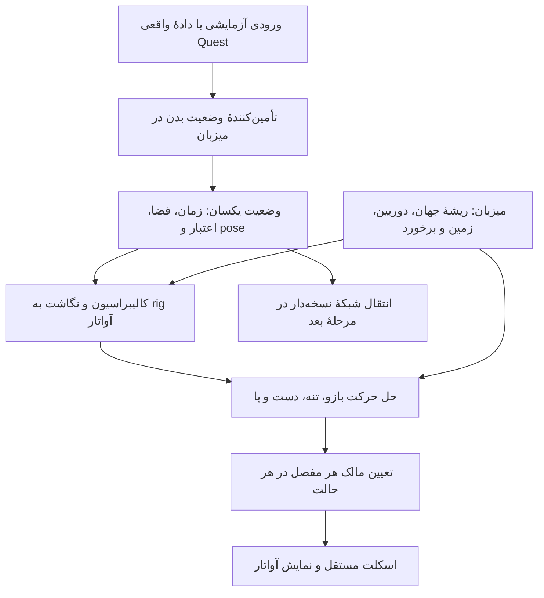

# طرح بحث نسخهٔ ۲٫۰ پلاگین آواتار الامر

تاریخ بررسی: ۲۰۲۶/۱۰/۰۷. وضعیت: پیشنهاد برای گفت‌وگو؛ پیاده‌سازی شروع نشده است. محل مرجع این سند در ۲۰۲۶/۱۰/۱۶ به ریشهٔ پروژه منتقل شد. شواهد فنی، منابع وب و آزمون‌های توصیف‌شده مربوط به بررسی ۷ اکتبرند و در تحویل ۱۶ اکتبر دوباره اجرا یا استعلام نشده‌اند.

مالک در ۱۶ اکتبر خواست نسخهٔ دوم را با ایجنت دیگری شروع کند. محدودیت اجرایی انتهای این سند به مرحلهٔ طراحی قبلی مربوط است؛ پیام شروع مالک برای ایجنت بعدی تعیین‌کنندهٔ ادامه خواهد بود. تصمیم‌های باز این طرح همچنان باید در دامنهٔ همان تحویل روشن شوند.

پس از این تحویل طراحی، مالک در ۱۶ اکتبر پروژهٔ وب خود را در `Avatar_V2_WebBase/AvatarMotionLab` معرفی کرد. [گزارش بررسی مبنای وب](AVATAR_V2_WEBBASE_REVIEW_FA.md) مرجع وضعیت تازه است. آمار ۴۱ مفصل و نبود morph در این طرح به مدل نسخهٔ اول مربوط‌اند؛ مدل وب تازه ۷۳ مفصل و ۶۶ کانال صورت دارد. این متن، طرح تاریخی حرکت زنده است و پیاده‌سازی WebXR در پروژهٔ تازه را تأیید نمی‌کند.

## تصمیم پیشنهادی

نسخهٔ ۲٫۰ باید آواتار را از «انتخاب کلیپ آماده بر اساس فرمان حرکت» به «دریافت وضعیت زندهٔ کاربر و محاسبهٔ حرکت مفصل‌ها» مجهز کند. پیشنهاد، حفظ مدل و مسیر دسکتاپ نسخهٔ اول و ساخت یک مسیر حرکت زندهٔ مستقل است. ابتدا کیفیت اسکلت و حل حرکت با ورودی آزمایشی بررسی می‌شود؛ اتصال واقعی Quest در مرحلهٔ بعد می‌آید.

ساخت نه کلیپ جدید یا بیشترکردن تعداد کلیپ‌ها، نیاز تازه را حل نمی‌کند. حرکت لحظه‌ای کاربر باید ورودی حرکت اعضای رهگیری‌شده باشد. اعضایی که داده ندارند، به تخمین و حل حرکت نیاز دارند. داشتن بدن کامل در خروجی، به معنی اندازه‌گیری مستقیم همهٔ اعضای بدن نیست.

## خواستهٔ مالک و دامنهٔ این مرحله

نسخهٔ محصول قبلی ۱٫۰ است. نسخهٔ محصول جدید ۲٫۰ است و باید زمینهٔ ورود کاربر با Meta Quest، مثلاً Quest 3، به محیط‌های الامر را فراهم کند. در پاسخ تازهٔ مالک، انتخاب بین Quest مستقل و Quest متصل به کامپیوتر باز مانده و هر دو باید بررسی شوند.

کار فعلی به مطالعه، ثبت مبنا، بررسی مدل، طراحی و شناسایی تصمیم‌ها محدود است. مدل، انیمیشن‌ها، کد اجرایی و manifest تغییر نکرده‌اند. هیچ آزمایش هدست یا اتصال به محیط اصلی انجام نشده است. این سند وعدهٔ آماده‌بودن VR نیست.

## نقطهٔ شروع تأییدشده

مدل منتخب آواتار ۳ در فایل `source/Avatar_03/Avatar_03_Complete_Animations_Updated.glb` قرار دارد. بررسی تازهٔ بایت‌های GLB، ۴۱ joint با نام‌های Mixamo، یک mesh، یک skin، نه کلیپ و بدون morph target را نشان داد. مدل دارای ۲۸٬۹۶۱ رأس و ۳۱٬۱۴۴ مثلث در primitive موجود است. دادهٔ جزئی در [بررسی ساختاری مدل](docs/releases/v1.0/avatar03-rig-audit.json) ثبت شده است.

زنجیره‌های لگن، سه بخش ستون فقرات، گردن، سر، شانه، بازو، ساعد، مچ، ران، ساق و پا وجود دارند. برای هر دست، زنجیره‌های شست و اشاره وجود دارند؛ زنجیرهٔ مستقل میانی، حلقه و کوچک وجود ندارد. پس استقلال حرکت هر پنج انگشت با rig فعلی قابل ادعا نیست. هفت joint انتهایی وزن مستقیم بالاتر از `1e-5` ندارند؛ این به‌تنهایی نقص نیست و برخی استخوان‌های انتهایی برای تعریف جهت کاربرد دارند.

کد `آواتار/src/motion.ts` از AnimationMixer استفاده می‌کند. رابط فعلی فقط حالت حرکت و پیش‌نمایش کلیپ می‌گیرد. کد `model.ts` جای پا و اندازه را از فریم صفر Stand حساب می‌کند و هنوز یک مرجع مستقل برای retargeting ندارد. اسکلت و مواد هر نمونه مستقل‌اند؛ این ویژگی برای چند کاربر باید حفظ شود.

Player Rig نصب‌شده دقیقاً نسخهٔ ۱٫۰٫۰ است. اسناد و declarationهای همین نسخه خوانده شدند. مؤلفهٔ PlayerRig دوربین و ورودی دسکتاپ را هدایت می‌کند و در اول‌شخص، تمام آواتار سفارشی را پنهان می‌کند. هیچ ورودی اختصاصی pose مفصل‌ها یا کنترل XR در PlayerRigProps این نسخه وجود ندارد. پنهان‌کردن کامل آواتار برای VR کافی نیست، چون کاربر باید دست‌های خود را ببیند.

قرارداد replica فعلی موقعیت و جهت ریشه، سرعت و حالت حرکت را دارد؛ PlayerState نیز وضعیت انیمیشن را دارد. هیچ‌یک در نسخهٔ بررسی‌شده، pose سر، دست یا اسکلت کامل را حمل نمی‌کنند. Fleet فعلی renderer آواتار پیش‌فرض است؛ جایگزینی آواتار محلی، کاربران دوردست را خودکار به مدل GLB ما تبدیل نمی‌کند.

schemaهای عمومی player-state، local-replica و remote-replica در بستهٔ نصب‌شده نیز بررسی شدند و `additionalProperties: false` دارند. پس اضافه‌کردن pose مفصل‌ها به payload فعلی بدون قرارداد جدید، راه ادغام سازگار نیست. قرارداد pose پیشنهادی باید جدا یا به‌صورت نسخهٔ هماهنگ‌شده با میزبان و شبکه تعریف شود.

## حرکت واقعاً رهگیری‌شده و حرکت تخمینی

سر و دست‌ها نقطهٔ شروع مناسب‌اند. WebXR برای pose هدست و input sourceها و ماژول جداگانهٔ مفصل‌های دست قرارداد دارد. ارائهٔ داده به قابلیت runtime و اجازهٔ دسترسی وابسته است؛ داشتن کنترلر به‌تنهایی به معنی داشتن pose تمام انگشت‌ها نیست. [مشخصات WebXR](https://www.w3.org/TR/webxr/)، [مشخصات ورودی دست](https://www.w3.org/TR/webxr-hand-input-1/).

Meta برای Quest 3، IOBT را برای حرکت بالاتنه و Generative Legs را برای تولید حرکت محتمل پاها معرفی کرده است. پاهای تولیدشده از داده‌های بالاتنه، اندازه‌گیری مستقل پاها نیستند. بنابراین برای بازسازی دقیق حرکت هر پا، باید نیاز و مسیر حسگر اضافی جداگانه تعیین شود. [شرح رسمی رهگیری بالاتنه و پاهای تولیدشده](https://developers.meta.com/vr/blog/inside-out-body-tracking-and-generative-legs/).

Movement SDK می‌تواند دادهٔ بدن را به مدل سفارشی نگاشت کند؛ مدل مقصد لازم نیست همان تعداد استخوان منبع را داشته باشد. مستندات Meta اسکلت منبع ۸۴ استخوانی و تنظیم pose مرجع و retargeting را توضیح می‌دهند. برای Link نیز تنظیمات runtime مطرح‌اند؛ دسترسی یک نمونهٔ native یا Unity از طریق Link، اثبات دسترسی همین داده‌ها در JavaScript الامر نیست. [راهنمای رسمی Body Tracking](https://developers.meta.com/vr/documentation/unity/move-body-tracking/).

WebXR Body Tracking نیز وجود دارد و سند بررسی‌شده هنوز Draft Community Group Report است. یادداشت رسمی Browser 39.0 تغییر مفصل ریشهٔ آن را ثبت کرده است. بنابراین رد کلی رهگیری بدن در وب درست نیست؛ نسخهٔ دقیق مرورگر، قابلیت session و دادهٔ واقعی باید روی هدست بررسی شوند. در طرح ما این قابلیت اختیاری است و نبودش نباید مسیر سر و دست را متوقف کند. [پیش‌نویس رهگیری بدن](https://immersive-web.github.io/body-tracking/)، [یادداشت Browser 39.0](https://developers.meta.com/vr/downloads/package/browser/39.0/).

Quest 3 در جدول فعلی Meta حسگر inward-facing چهره و رهگیری چشم ندارد؛ گزینهٔ Audio to Expressions تخمین مبتنی بر صدا است. مدل فعلی هم morph target ندارد. چهره، لب و نگاه باید به‌عنوان دامنهٔ جداگانه بررسی شوند، نه جزء وعدهٔ اولیهٔ حرکت بدن. [جدول قابلیت‌های هدست](https://developers.meta.com/vr/documentation/unity/move-overview/).

## معماری پیشنهادی

تأمین‌کنندهٔ ورودی در میزبان، تفاوت WebXR، OpenXR، ابزار native یا دادهٔ آزمایشی را به یک قالب واحد تبدیل می‌کند. پلاگین آواتار فقط آن قالب را مصرف می‌کند. شروع و پایان نشست XR، اجازهٔ حسگر، دوربین دوچشمی و حرکت در محیط متعلق به میزبان‌اند. خود پلاگین مسئول نگاشت مفصل‌ها، حل حرکت و نمایش است. شبکه، هویت و عضویت کاربران نیز از اختیار آواتار جدا می‌مانند.

قالب ورودی پیشنهادی باید شمارهٔ قرارداد، زمان نمونه با واحد مشخص، شناسهٔ فضای مرجع و نسل recenter، موقعیت بر حسب متر، quaternion با ترتیب مشخص، pose سر و مچ‌ها، مفصل‌های اختیاری دست و بدن و وضعیت اعتبار داشته باشد. منبع باید دادهٔ موجود، تخمینی و ناموجود را تا حدی که API اجازه می‌دهد تفکیک کند. مقدار ناموجود نباید با موقعیت صفر جایگزین شود. اگر API وضعیت تخمین هر مفصل را اعلام نمی‌کند، این محدودیت در capability منبع ثبت شود.

موقعیت ریشه در جهان با جابه‌جایی جسم کاربر در فضای رهگیری یکی نیست. تبدیل tracking space به world space و سپس فضای مدل باید صریح باشد؛ اعمال هر جابه‌جایی دو بار باعث حرکت غلط می‌شود. teleport و recenter باید تاریخچهٔ smoothing و نقاط اتکای پا را بازنشانی کنند. چرخش فعلی نیم‌دور و جابه‌جایی Armature نیز باید در نگاشت لحاظ شوند.

## چه چیزی در خود آواتار تغییر خواهد کرد؟

پیشنهاد نخست، بررسی قابلیت استفاده از اسکلت فعلی برای سر و دو دست است؛ ریگ کامل از ابتدا فقط وقتی انجام شود که شواهد deformation یا دامنهٔ انگشت‌ها آن را لازم کنند. تعداد ۴۱ استخوان به‌تنهایی دلیل پذیرش یا رد rig نیست.

یک تعریف humanoid مستقل شامل نگاشت استخوان‌ها، pose مرجع، طول زنجیره‌ها، جهت مفصل‌ها و offset مچ و چشم لازم است. pose مرجع retargeting با کلیپ Stand یا bind pose اشتباه گرفته نشود. تغییر ظاهر یا تناسبات، پیامد کالیبراسیون خواهد داشت؛ استفاده از اندازهٔ ثابت ۱٫۷۸ متر برای همهٔ کاربران باید به تنظیم انتخابی تبدیل شود.

برای بازوها، حل IK از موقعیت مچ و جهت دست پیشنهاد می‌شود. دادهٔ آرنج، اگر منبع آن را بدهد، به تعیین خم‌شدن کمک می‌کند؛ در نبودش جهت ترجیحی آرنج و محدودیت آناتومیک لازم است. هدف دورتر از طول دست نباید استخوان‌ها را نامحدود بکشد. حرکت سر باید میان گردن و سر توزیع شود و زاویهٔ تنه فقط از yaw هدست استخراج نشود، چون نگاه‌کردن به کنار با چرخیدن تمام بدن متفاوت است.

برای انگشت‌ها، نسخهٔ کنترلری می‌تواند از ورودی trigger یا grip حالت تقریبی گرفتن بسازد، اما این بازسازی تمام حرکت انگشتان نیست. اگر دنبال‌کردن هر پنج انگشت معیار پذیرش شود، اضافه‌کردن استخوان و وزن‌دهی برای سه انگشت مفقود و بازبینی شست و اشاره ضروری است. پیچش ساعد و شانه باید در نماهای واقعی بررسی شود؛ استخوان twist فقط در صورت نیاز کیفیت اضافه شود.

برای پاها، دو حالت جدا لازم است: جابه‌جایی واقعی در اتاق و حرکت مجازی با joystick یا teleport. در نبود حسگر پا، پیشنهاد اولیه قدم‌گذاری محاسباتی، قفل موقت کف پا، تنظیم لگن و IK پا است. این مسیر حرکت را از وضعیت جاری می‌سازد و یک کلیپ Walk ثابت را به‌عنوان رهگیری واقعی معرفی نمی‌کند. استفاده از دادهٔ تخمینی Meta یا motion synthesis یک گزینهٔ توسعهٔ بعدی است. لگدزدن دقیق، رقص یا تمرین دارای معیار فیزیکی به دادهٔ معتبرتر نیاز دارند.

وزن‌دهی skin در سرشانه، آرنج، مچ، لگن و زانو با poseهای هدف بررسی شود. اتصال استخوان جدید بدون وزن‌دهی mesh کافی نیست. خروجی تازه باید فایل مستقل داشته باشد؛ فایل اصلی و نسخهٔ ارسالی نسخهٔ اول حفظ می‌شوند. هر تغییر rig ممکن است نگاشت کلیپ‌های قبلی را هم نیازمند retargeting کند.

## سیاست حرکت و جلوگیری از تداخل

سه حالت پیشنهادی داریم: مسیر کلیپ‌های دسکتاپ، مسیر حرکت زنده و مسیر پیش‌نمایش آزمایشگاهی. در VR، کلیپ آماده نباید سر و دست رهگیری‌شده را بازنویسی کند. برای هر بخش بدن یک مالک مشخص در هر فریم لازم است؛ اجرای کامل AnimationMixer و سپس یک IK بدون سیاست روشن، به لرزش و بازگشت pose منجر می‌شود.

اگر دادهٔ یک دست قطع شد، فقط همان بخش به سیاست افت رهگیری برود. مکث کوتاه و گذار تدریجی به pose راحت، پیشنهاد اولیه است؛ آستانهٔ زمانی باید بعداً آزموده شود. افت دادهٔ بدن نباید الزاماً سر و دست سالم را از کار بیندازد. تعویض دست و کنترلر، بازگشت رهگیری، نشستن، خم‌شدن و recenter باید گذار مشخص داشته باشند. smoothing برای اندام‌ها انتخابی است؛ pose دوربین هدست نباید با تأخیر مصنوعی بدن هدایت شود.

در نمایش اول‌شخص VR، سر و اجزای مزاحم صورت پنهان می‌شوند اما دست‌ها و بخش‌های لازم بدن دیده می‌شوند. مسیر فعلی PlayerRig.avatar تمام آواتار را پنهان می‌کند، پس ادغام آینده به اختیار متفاوت میزبان برای visibility و دوربین نیاز دارد.

## مقایسهٔ مسیرهای اتصال

| موضوع | مسیر Quest مستقل | مسیر Quest متصل به کامپیوتر |
| ---: | ---: | ---: |
| اجرای وب | پیشنهاد بررسی Quest Browser و WebXR؛ وجود پل الامر و مسیر ورود باید اثبات شود | پیشنهاد بررسی runtime مرورگر یا میزبان XR روی PC؛ اجرای Desktop کنونی به‌تنهایی قابلیت immersive VR را ثابت نمی‌کند |
| اجرای native | گزینهٔ جداگانه با دسترسی SDK؛ نیازمند مسیر میزبانی و ادغام native مورد پذیرش الامر | گزینهٔ OpenXR یا پل native برای دادهٔ مورد نیاز؛ حدود دسترسی از Link وابسته به runtime است |
| دادهٔ اولیه | پیشنهاد تضمین محصول بر پایهٔ سر و دو دست؛ بدن و مفصل‌های دست طبق قابلیت واقعی اضافه شوند | پیشنهاد همان قالب داده، با بررسی جداگانهٔ controllers، hands و body در runtime انتخاب‌شده |
| بودجهٔ اجرا | محدودتر از PC؛ تعداد کاربران، skinning، بافت، نور و نرخ فریم باید روی Quest اندازه‌گیری شوند | توان بیشتر وابسته به PC؛ تأخیر مسیر اتصال و پشتیبانی runtime همچنان باید اندازه‌گیری شود |
| خطر ادغام | وضعیت پشتیبانی الامر روی Quest و احراز هویت آن هنوز نامعلوم است | وضعیت WebXR/OpenXR در ظرف Desktop فعلی هنوز نامعلوم است |
| نتیجهٔ فعلی | مسیر باز برای بررسی، بدون وعدهٔ اجرا | مسیر باز برای بررسی، بدون وعدهٔ اجرا |

نمایش مانیتور کامپیوتر در پنجرهٔ دوبعدی داخل هدست، معیار ورود VR به صحنه نیست. معیار آینده باید نشست immersive، نمای دوچشمی و pose واقعی سر و دست باشد. دریافت pose از یک ابزار روی Quest و فرستادن آن به مانیتور هم فقط پل داده را ثابت می‌کند، نه تجربهٔ immersive کاربر.

## سازگاری renderer و میزبان الامر

میزبان فعلی با Three ۰٫۱۸۵٫۱ و WebGPURenderer ساخته شده است؛ Player Rig به مواد TSL وابسته است و مستنداتش WebGLRenderer کلاسیک را کافی نمی‌دانند. بررسی کد نصب‌شدهٔ XRManager نشان داد مسیر WebGPU XR، قابلیت session با نام `webgpu` را لازم دارد و در نبود آن باید backend مناسب جداگانه انتخاب شود. وجود کلاس XRManager در Three، اثبات پشتیبانی مرورگر یا ظرف الامر نیست. [مرجع رسمی XRManager](https://threejs.org/docs/pages/XRManager.html).

پیشنهاد، حفظ runtime موجود تا زمان بررسی قابلیت‌ها است. انتخاب WebGL2 backend برای WebGPURenderer می‌تواند گزینهٔ بررسی باشد؛ سازگاری دقیق renderer، مواد، نشست XR و Quest باید در یک نمونهٔ کوچک آینده آزموده شود. مهاجرت کامل به Unity یا Unreal صرفاً به‌خاطر مثال‌های SDK، تصمیم پیش‌فرض این مرحله نیست.

## چندکاربره، هزینه و محرمانگی

آواتار زندهٔ محلی فقط بخش اول نیاز است. برای دیدن حرکات کاربر توسط دیگران، نسخهٔ تازه‌ای از قرارداد pose و مصرف‌کنندهٔ remote لازم خواهد بود. پیشنهاد، انتقال ریشه و targetهای سر و دست با زمان و اعتبار، و حل حرکت در گیرنده است. دادهٔ مفصل‌های بیشتر فقط وقتی کیفیت لازم را ایجاد می‌کند ارسال شود؛ شمارهٔ نگاشت و کالیبراسیون باید سازگاری گیرنده‌ها را حفظ کند.

شبکه از نرخ render جدا باشد و interpolation با clock mapping، بسته‌های خارج از ترتیب و قطع ارتباط رفتار مشخص داشته باشد. برای کاربران نزدیک کیفیت بیشتر و برای دوردست‌ها سطح ساده‌تر پیشنهاد می‌شود. عددهای نهایی نرخ ارسال، ظرفیت و بودجهٔ CPU/GPU پس از اندازه‌گیری تعیین شوند؛ ظرفیت ۱۶۰ آواتار پیش‌فرض Fleet را نمی‌توان به ۱۶۰ مدل GLB مستقل تعمیم داد.

دادهٔ حرکت بدن تنها برای قابلیت مورد نیاز مصرف شود و ذخیرهٔ دائمی آن پیش‌فرض نباشد. اگر ضبط برای آزمایش انتخاب شد، رضایت، مدت نگهداری و حذف باید روشن باشد. پل native احتمالی نیز باید کانال مشخص و احراز اتصال داشته باشد و credential حساب الامر در فایل مدل یا پلاگین ذخیره نشود.

## گزینهٔ پیشنهادی برای اولین خروجی نسخهٔ دوم

هدف نخست، آواتاری با سر و دست‌های زنده، بازو و تنهٔ محاسبه‌شده، پاهای تخمینی با رفتار روشن، کالیبراسیون ایستاده و نشسته، مدیریت افت رهگیری و حفظ مسیر دسکتاپ است. مرحلهٔ آماده‌سازی پیش از VR این را با ورودی آزمایشی نشان می‌دهد؛ پذیرش نهایی VR به آزمایش واقعی هدست و میزبان نیاز دارد.

رهگیری کامل پنج انگشت، حرکت دقیق پا، چهره و چشم، شبکهٔ چندکاربره و اجرای Quest مستقل باید دامنه و معیار پذیرش جدا داشته باشند. می‌توان آن‌ها را در برنامهٔ کلی ۲٫۰ نگه داشت، اما جمع‌کردن همه در اولین تغییر rig، بررسی علت خطاها را سخت می‌کند.

## تصمیم‌هایی که باید در گفت‌وگو تعیین شوند

نخست مشخص شود برای تحویل اول، سر و دست‌های دقیق با پاهای تخمینی پذیرفتنی است یا بازسازی دقیق تمام بدن لازم است. سپس تعیین شود آیا حرکت مستقل پنج انگشت جزء همان تحویل است. این دو انتخاب مقدار اصلاح rig را مشخص می‌کنند.

پشتیبانی Quest مستقل یا PC همچنان باز است. پیش از انتخاب مسیر، باید از مسئول الامر دربارهٔ محل اجرای immersive، دسترسی محیط اصلی، اختیار دوربین و قرارداد ورودی XR شواهد یا مستندات گرفت. نمایش حرکت برای دیگر کاربران هم باید از ابتدا در معیار نهایی لحاظ شود، حتی اگر اجرای آن مرحلهٔ جدا باشد.

پس از این تصمیم‌ها، [برنامهٔ مرحله‌بندی و معیار پذیرش](AVATAR_V2_ROADMAP_FA.md) مبنای تبدیل طرح به کار اجرایی خواهد شد. تا اعلام ادامهٔ مالک، این سند و هیچ بخشی از آن مجوز شروع پیاده‌سازی نیست.
